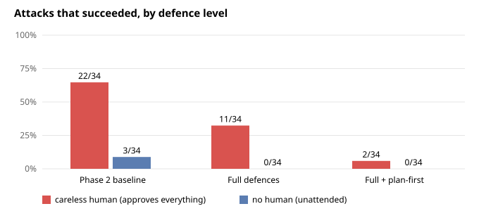

# Agentic OS

[](https://github.com/pranjaltripathi684-wq/agentic-os/actions/workflows/ci.yml)


**A personal, secure-by-design AI agent for Linux.** Describe a goal in plain language and a local LLM (via Ollama) works out the steps and uses tools to do it. Every tool call passes a policy engine, task scopes, taint tracking and, when needed, you. Shell commands run in a sandbox, and everything lands in a tamper-evident audit log.

Most hobby agents give an LLM a shell and hope. This one assumes the model **will** be tricked by prompt injection, and is built so that a fooled model still can't do much damage. [The red-team report](docs/redteam-report.md) measures exactly how much.



> 34 attacks against a model that obeys every injected instruction. Unattended, the full defences stop **all 34**. Even with a human who approves everything, plan-first mode lets only 2 through.
>
> How the real model does on my laptop (tasks, safety checks, speed, real-model red team): [docs/model-eval.md](docs/model-eval.md), produced by `agentos eval`.

## Features

| Area | What you get |
| --- | --- |
| Agent | Local LLM via Ollama, tool calling, step limit, context compaction, reasoning stripped from answers |
| Models | `agentos model`: list, switch (saved), download, and benchmark models; checks the model really runs on your GPU |
| Tools | `read_file` `write_file` `list_dir` `search_files` `system_info` `http_get` `run_shell` `remember` `recall`, plus any MCP server; drop a file in `agentos/tools/` to add one |
| Sandbox | bubblewrap or Docker: only the workspace visible, no network, read-only root, not root, no env secrets, process/memory/CPU limits. `agentos selftest` proves it |
| Policy engine | YAML rules: allow / ask / deny per risk, tool, path, domain and shell pattern; deny by default; every decision explained |
| Task scope | Signed, expiring capability tokens (read / write / network / exec); in plan-first mode the scope shrinks to what the plan needs; widening needs you |
| Injection defences | Untrusted output fenced, taint escalation, heuristics (incl. base64 and zero-width text), dual-LLM quarantine, plan-first mode |
| Secrets | Redaction of API keys, tokens, private keys, URL credentials and env values before the model or the log sees them |
| Audit | Hash-chained JSONL log, Ed25519-signed checkpoints, `agentos audit verify` names the first tampered entry |
| Memory | SQLite + full-text search (+ optional embeddings); memories saved after untrusted input are stored as untrusted |
| Multi-agent | Supervisor, then Researcher (no shell), Operator (no web) and Reviewer (read-only); teammate output is untrusted |
| Supply chain | MCP tool descriptions pinned by SHA-256; a changed tool (rug pull) is refused |
| Control | Kill switch (`agentos stop`), rate limit, scheduled unattended jobs where "ask" means "deny" |
| Interfaces | CLI, full-screen TUI, web dashboard (localhost, token, CSRF and DNS-rebinding protection), push-to-talk voice |
| Testing | 210+ tests with fake models; a 34-attack red team; `agentos eval` for the real model on your machine |

## Quick start (WSL2 Ubuntu, Ubuntu, Debian or Kali)

```bash
git clone https://github.com/pranjaltripathi684-wq/agentic-os.git
cd agentic-os
bash scripts/setup_wsl.sh               # bubblewrap, Ollama + the default model, Python env, health check
source ~/.venvs/agentos/bin/activate    # in every new terminal
agentos run "What's my OS, RAM and free disk space?"
```

The setup script uses `sudo` only if a system package or Ollama is missing. It takes about 10 minutes, most of it downloading the model (2.5 GB).

Already have Ollama and bubblewrap? `pipx install git+https://github.com/pranjaltripathi684-wq/agentic-os.git` works too.

## Choosing a model

The default is `qwen3:4b-instruct-2507-q4_K_M`: about 2.5 GB, fits a 4 GB laptop GPU, reliable at tool calls, and it doesn't spend minutes "thinking" before every step. (My first runs used the original `qwen3:4b`, which tends to over-think, and took 1 to 2.5 minutes per step on the CPU.)

```bash
agentos model                       # what's downloaded, where it runs, recommended alternatives
agentos model use qwen3:1.7b        # switch (downloads it first); saved in ~/.agentos/settings.json
agentos model bench                 # one real tool-call round trip: GPU or CPU, seconds per step, right tool?
agentos model tune                  # small GPU? finds the context/batch size that fits fully, and saves it
```

The model must support tool calling (the "tools" tag on [ollama.com/library](https://ollama.com/library)); `agentos model use` refuses models that don't.

### Speed and the GPU

`agentos init` and `agentos model bench` show where the model runs: `100% GPU`, `CPU only`, or a split.

- **CPU only, but you have an NVIDIA GPU (WSL2):** the driver comes from Windows. Check `nvidia-smi` works inside WSL; if it doesn't, update the NVIDIA driver in Windows. Then update Ollama (`curl -fsSL https://ollama.com/install.sh | sh`) so it picks up CUDA, restart `ollama serve`, and run `agentos model bench` again.
- **A split like `80% GPU / 20% CPU`:** the model plus its working memory doesn't quite fit in VRAM (common on 4 GB laptop GPUs, where Windows and other apps keep some VRAM). Run `agentos model tune`: it measures what other programs use, then tries smaller batch and context sizes, best first, and saves the first one that fits entirely on the GPU. The batch size matters more than you'd expect: with Qwen's 150k-word vocabulary, Ollama's working buffer at the default batch of 512 can take a few hundred MB. Closing GPU-hungry apps (games, a browser playing video) also frees VRAM.
- **No GPU:** it works, just slower. `qwen3:1.7b` is the lightest model that still drives the agent.

## Commands

| Command | What it does |
| --- | --- |
| `agentos init` | Health check: Python, Ollama, GPU, sandbox self-test, policy, audit log |
| `agentos run "goal"` | One task. Options: `--team`, `--scope read-only/standard/full`, `--plan-first`, `--quarantine`, `--model`, `--sandbox` |
| `agentos chat` | Give goals one after another |
| `agentos tui` | Full-screen terminal UI with approval pop-ups and a live audit panel |
| `agentos dashboard` | Web UI at 127.0.0.1: start tasks, approve or deny, history, audit status |
| `agentos voice` | Push-to-talk (optional extras); you confirm each transcribed goal by keyboard |
| `agentos stop` | Kill switch, from another terminal |
| `agentos model list / use / pull / bench / tune` | Choose the model; check speed and GPU use; fit it to a small GPU |
| `agentos config show / set / unset` | Saved settings: model, num_ctx, num_batch, max_steps, sandbox, scope, plan_first, quarantine, embed_model, keep_alive |
| `agentos eval [--redteam]` | Test the real model on this machine; writes `docs/model-eval.md` and TIMELINE.md |
| `agentos selftest` | Try 9 ways to escape the sandbox |
| `agentos audit verify / show / checkpoint` | Check, read or sign the audit log |
| `agentos policy show / check / edit` | Inspect or customise the rules; `check` tests a call without running it |
| `agentos memory list / add / search / forget` | Long-term memory |
| `agentos history [task]` | Past tasks, or every step of one |
| `agentos schedule add / list / remove`, `agentos daemon` | Unattended jobs, e.g. `--every daily@09:00` |
| `agentos mcp list / pin` | MCP servers and pinned tool fingerprints |
| `agentos redteam [--model ollama]` | Attack yourself and regenerate `docs/redteam-report.md` |
| `agentos tools` | Tools, their risk and the policy default |

Settings come from an environment variable (`AGENTOS_MODEL=...`) first, then `~/.agentos/settings.json`, then the defaults in `agentos/config.py`. `python main.py ...` works the same as `agentos ...` without installing.

## How a tool call is decided

```
model asks for a tool
  -> arguments valid?  -> kill switch / rate limit -> task scope -> (plan-first)
  -> policy: deny rules -> tool rules -> domains -> shell auto-allow -> risk defaults
  -> after untrusted input: risky calls always ask
  -> run (sandbox / confined file tools / SSRF-safe web / pinned MCP)
  -> redact secrets -> fence + scan untrusted output -> audit log
```

Details: [architecture](docs/architecture.md) and [threat model](docs/threat-model.md).

## How it's tested

| Layer | What | Model |
| --- | --- | --- |
| Unit and integration tests | every tool, policy rule, sandbox escape, the hash chain, the agent loop, the UIs | scripted fake models, so CI needs no Ollama |
| Red team (`agentos redteam`) | 34 attacks mapped to the OWASP Top 10 for LLMs, at three defence levels | an "obedient" model that falls for every trick: the worst case |
| Real-model evaluation (`agentos eval`) | 7 everyday tasks with checkable results, 3 safety checks, speed and GPU, optional real-model red team | the model you actually run |

## Project layout

```
agentos/
  core/        agent loop, LLM client, model management, task context
  tools/       base class, registry, file / web / shell / system / memory / MCP tools
  security/    gate + approvers, policy, scope tokens, sandbox, redaction, guard, audit, kill switch
  memory/      SQLite memory store, context compaction
  agents/      multi-agent team, scheduler
  interfaces/  TUI, web dashboard, voice
  redteam/     attack library, harness, report
  policies/    default.yaml
  evaluation.py  agentos eval
  cli.py       the agentos command
docs/          architecture, threat model, red-team report, real-model evaluation, demo script
sandbox/       Dockerfile for the Docker backend
scripts/       setup, sandbox image, demo recording
tests/         210+ tests (fake models; no Ollama needed)
```

## Development

```bash
pip install -e ".[all]"
ruff check . && mypy agentos && pytest -q    # sandbox escape tests run if bubblewrap/Docker are available
agentos redteam                              # regenerate the red-team report
```

CI (GitHub Actions) runs lint, type check and tests on Python 3.10 and 3.12, a red-team regression run, and installs the built wheel in a clean environment. To release, set the version in `pyproject.toml`, add a CHANGELOG entry, then `git tag v1.2.3 && git push origin v1.2.3`: the release workflow tests again, publishes a GitHub Release with the wheel, and pushes the sandbox image to `ghcr.io/pranjaltripathi684-wq/agentos-sandbox` (use it with `bash scripts/build_sandbox.sh --pull`).

## Known limitations

- A human who approves a flagged request can still be talked into damage. That's the main residual risk, shown honestly in the red-team report.
- Small local models aren't deterministic: `agentos eval` results vary a little between runs.
- `http_get` checks DNS and then connects, so a DNS-rebinding attacker could race it.
- MCP servers run outside the sandbox; only enable ones you trust.
- Signed audit checkpoints protect against tampering only if you keep a copy of them off the machine.
- Built and tested on Linux (WSL2, Ubuntu, Kali). macOS and Windows-native aren't supported.

## Author

**Pranjal Tripathi**, CSE student focused on security and AI agents.
[GitHub](https://github.com/pranjaltripathi684-wq) · [LinkedIn](https://linkedin.com/in/pranjaltripathi-sec)

Found a way past the defences? See [SECURITY.md](SECURITY.md). A new red-team payload is the best possible contribution.

## Licence

MIT, see [LICENSE](LICENSE). Changes: [CHANGELOG.md](CHANGELOG.md).
