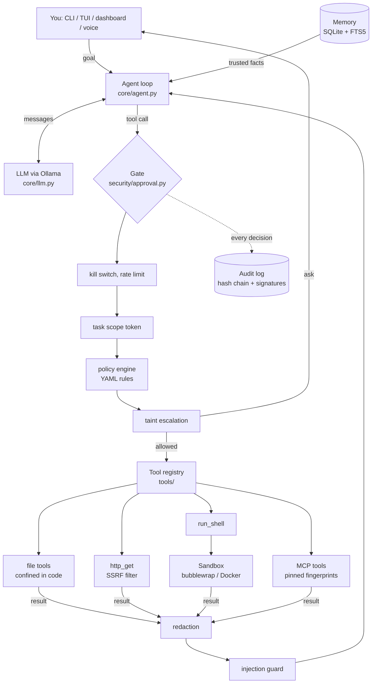

# Architecture

Agentic OS is an agent **runtime**, not a kernel. It runs on top of Linux. A local LLM turns a goal into tool calls, and every tool call passes through a stack of independent security layers before anything happens.

## The flow of one tool call

1. **The model asks.** The LLM never executes anything. It returns a request such as `{"name": "run_shell", "arguments": {"command": "df -h"}}`.
2. **Validation.** Arguments are checked against the tool's JSON schema, and unknown tools are rejected (`tools/base.py`).
3. **The gate** (`security/approval.py`) runs these checks in order:
   - **Kill switch:** has `agentos stop` been run?
   - **Rate limit:** more than 20 calls a minute?
   - **Task scope:** a signed, expiring capability token lists which risks (read, write, network, exec) this task may use (`security/scope.py`).
   - **Plan-first** (optional): after untrusted input, only tools the agent committed to beforehand.
   - **Policy:** `allow`, `ask` or `deny` from YAML rules, each decision with a reason and the rule that made it (`security/policy.py`).
   - **Taint escalation:** once untrusted content has been read, risky calls always ask.
   - **The human**, when needed.
4. **Execution.** File tools resolve paths and refuse anything outside the workspace. `http_get` refuses private addresses, including after redirects. `run_shell` runs inside a fresh sandbox (`security/sandbox.py`). MCP tools load only if their description fingerprint matches the pin.
5. **Inspection.** Secrets are redacted (`security/redact.py`). Untrusted output is fenced and scanned for injection patterns, and can optionally be summarised by a tool-less "quarantined" model call (`security/guard.py`). The task is marked tainted.
6. **Audit.** Every decision and result is appended to a hash-chained log, with optional Ed25519-signed checkpoints (`security/audit.py`).

## Components

| Package | What it does |
| --- | --- |
| `core/agent.py` | The loop: memory context, plan-first, compaction, tool handling, event hooks for UIs |
| `core/llm.py` | Ollama client; strips leaked reasoning; maps network errors to clear messages |
| `core/context.py` | Per-task context (task id, role, tainted) visible to tools |
| `tools/` | Tool base class and auto-discovering registry; file, web, shell, system, memory and MCP tools |
| `security/` | Gate and approvers, policy engine, scope tokens, sandbox, redaction, guard, audit log, kill switch |
| `memory/` | SQLite memory with provenance and full-text search; context compaction |
| `agents/` | Multi-agent team (supervisor, researcher, operator, reviewer); scheduler |
| `interfaces/` | Textual TUI, FastAPI dashboard, voice |
| `redteam/` | Attack library, harness, report generator |
| `cli.py` | The `agentos` command |

## Where state lives

Everything the agent must not be able to change lives in `~/.agentos/`. That folder is outside the workspace, so neither the file tools nor the sandbox can reach it. It's also outside OneDrive, so nothing syncs.

| File | Contents |
| --- | --- |
| `~/.agentos/audit.jsonl` | Hash-chained audit log |
| `~/.agentos/audit-checkpoints.jsonl`, `keys/` | Signed checkpoints and the Ed25519 key (mode 600) |
| `~/.agentos/memory.db` | Memories, task history, steps |
| `~/.agentos/policy.yaml` | Your policy (optional; otherwise the packaged default) |
| `~/.agentos/mcp_pins.json` | Approved MCP tool fingerprints |
| `~/.agentos/schedule.json` | Scheduled jobs |
| `~/agentos-workspace/` | The only folder the agent's tools can see (`/workspace` in the sandbox) |

## Design choices

- **Dependency injection everywhere.** The agent receives its model, approver, policy and tools as arguments. That's why 190+ tests run in seconds without Ollama, and why the TUI, dashboard and red-team harness reuse the same loop.
- **Defence in depth.** Every layer assumes the one before it failed. A Researcher agent has no `run_shell` tool *and* no `exec` scope. A shell command passes the policy *and* runs in the sandbox.
- **Deny by default, explain everything.** An unmatched policy rule is a denial, and every decision in the audit log carries the rule that made it.
- **One model, many roles.** The multi-agent team shares one loaded model with different system prompts, which keeps it inside 12 GB of RAM.
